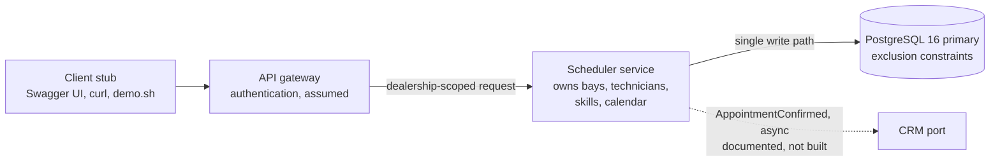
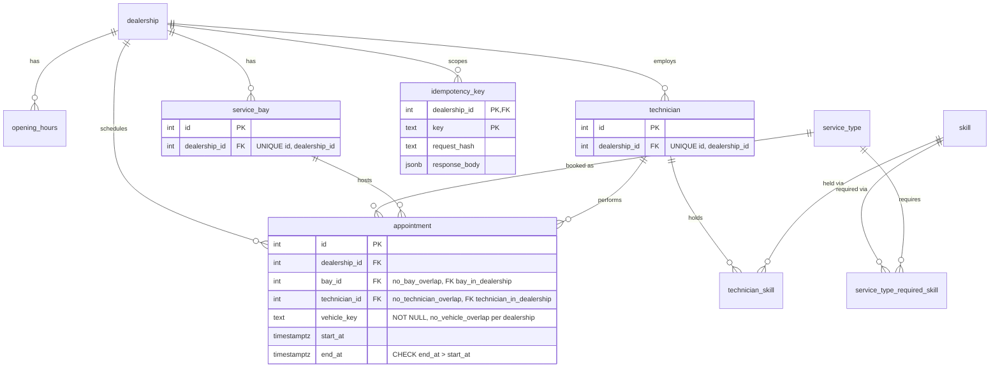
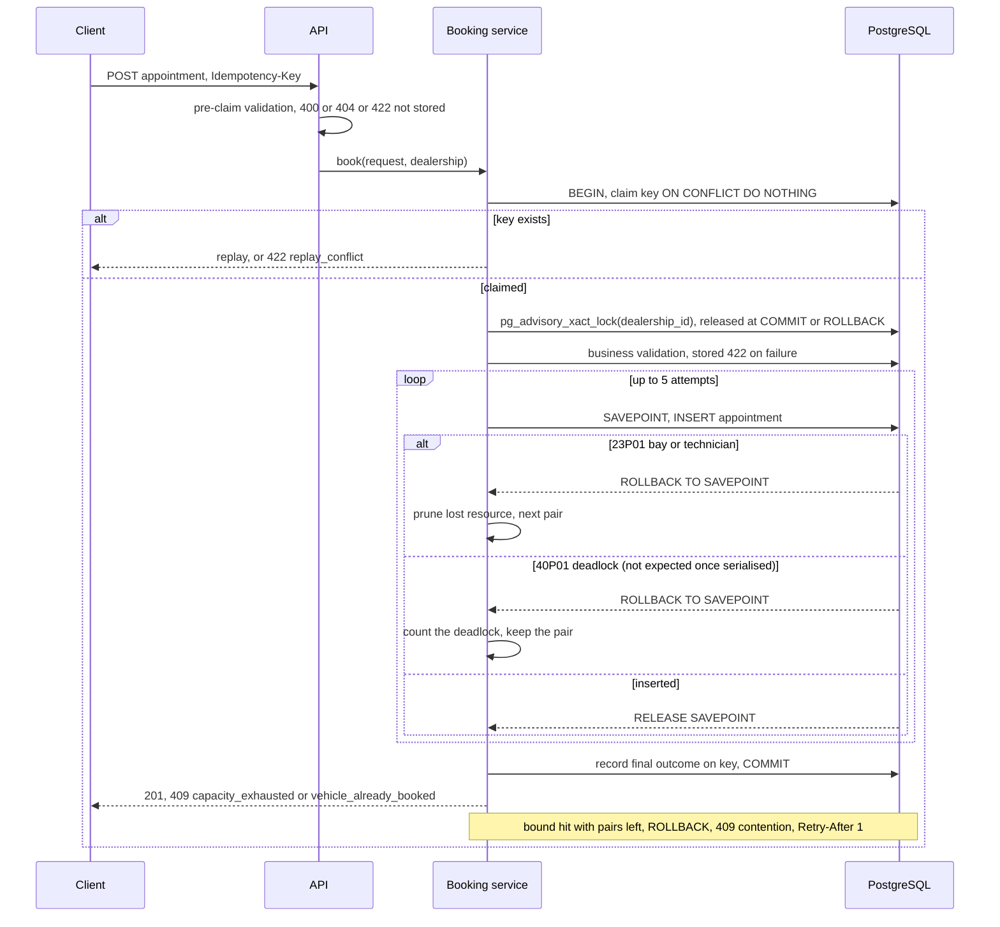
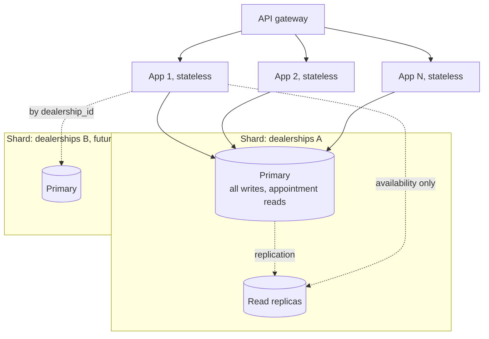
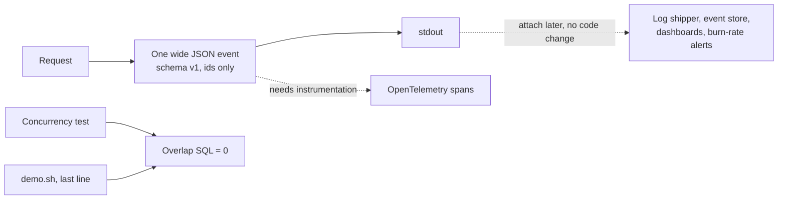
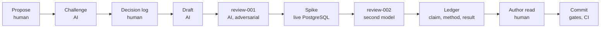

# System Design Document: Unified Service Scheduler (Scenario A, backend)

Python 3.12, FastAPI, PostgreSQL 16. Each decision, its rejected alternatives and its long tables live in [docs/adr/](adr/README.md); the sections below connect them.

## TL;DR

The database is the referee. A booking request lists free (bay, qualified technician) pairs, inserts one `appointment` row per attempt, and lets PostgreSQL exclusion constraints decide. A loser of a named resource conflict moves to the next pair, at most five times, and gets one answer that is never revoked. Bookings of one dealership run one at a time behind a transaction-scoped advisory lock, so attempts form no lock cycles (ADR-004 amendment, D-048). Three layers, each with its own job: the constraints are the invariant, the lock makes the normal path at most one attempt and deterministic, and the bounded retry is the fallback for a writer that bypasses the lock (D-050).

| Section | Answer | Where |
|---|---|---|
| 1. Architecture | One bounded service owns bays, technicians, skills and the calendar; tenant = `dealership_id`; the CRM is never on the booking path | ADR-003, ADR-007 |
| 2. Components | Three exclusion constraints (bay, technician, `vehicle_key`) and composite tenancy foreign keys hold for any writer | ADR-004 |
| 3. Data flow | Validate, claim the `Idempotency-Key`, take the dealership's advisory lock, one savepoint per attempt; 23P01 prunes the lost resource, 40P01 counts the attempt and the deadlock and prunes nothing; 201, final 409 `capacity_exhausted` or `vehicle_already_booked`, transient 409 `contention` | ADR-004, ADR-008 |
| 4. Technology | Python 3.12, FastAPI, psycopg 3, SQLAlchemy Core, Alembic, PostgreSQL 16 `btree_gist`; one primary, replicas for availability only, shard by dealership; 1,000 sites is an assumption | ADR-002, ADR-004 |
| 5. Observability | One wide JSON event per request on stdout is the product; servers attach later | ADR-013 |
| 6. GenAI | The author proposes, decides and overrides; AI challenges, drafts, reviews and verifies | [docs/ai/](ai/README.md) |
| 7. Security | Three trust zones: gateway (assumed), this service, future CRM; one stated gap, tenant binding of caller to dealership | ADR-014 |

## 1. Architecture diagram

The service replaces a manual workshop booking system (Scenario A, backend only, ADR-001). It owns bays, technicians, skills and the appointment calendar, and the invariant over them (ADR-003). Dealership zone and opening hours are a seeded local copy, so a booking never calls another service.

- Rationale: the owner of an invariant owns the data the invariant ranges over.
- Rule: every tenant table is partitioned by `dealership_id`; `skill`, `service_type` and `service_type_required_skill` are global reference data; `technician_skill` follows its technician.
- Rule: the CRM receives `AppointmentConfirmed` asynchronously (documented, not built) and reconciles; booking never calls it (ADR-007).

| Assumption | Resolution |
|---|---|
| "Check availability before confirming" | A guarantee: the availability checked still holds when the record commits (ADR-004) |
| Qualified | Holds every skill the service type requires; zero required skills means any technician; none qualified at the dealership is 422, not 409 (ADR-006) |
| Duration, hours | On the service type; the server computes `end_at`. Start must fall in opening hours; services may span days (ADR-009) |
| Customer and vehicle | Snapshot with an identifier: vehicle `id` or `vin`, customer `id` or `email` (ADR-007) |
| Authentication | Upstream gateway, assumed; the gateway contract and the trust boundary are in section 7 and ADR-014 |
| Ranges | Half-open, no turnaround buffer (ADR-005) |
| Limitations | No per-dealership service offering; bays and technicians are never retired |

## 2. Component roles

| Component | Role |
|---|---|
| API layer | Parses JSON, checks the key is a UUID, loads the dealership, validates the schema, all before BEGIN; maps outcomes to HTTP |
| Booking service | The only writer and transaction owner: takes the dealership's advisory lock after the key claim, converts the start, computes `end_at`, builds candidates, retries up to 5 attempts |
| Candidate query | Free bays x free qualified technicians in random order, so no pair is favoured by its position in a fixed list; read under the dealership lock, so it sees every committed booking of the dealership |
| Idempotency store | Claims the key in the booking transaction, replays or rejects a different body |
| Persistence adapter | Port `reserve(candidate) -> Confirmed or ResourceTaken`; maps 23P01 and 40P01 to `ResourceTaken` only around the savepoint INSERT, elsewhere 5xx |
| PostgreSQL 16 | Holds the invariant: non-overlap and tenancy for any writer |

- Rule: each exclusion constraint is `EXCLUDE USING gist (resource WITH =, tstzrange(start_at, end_at) WITH &&)`; half-open ranges allow back-to-back bookings.
- Rule: `vehicle_key` is the VIN, upper case with whitespace removed, when given, else `id:<vehicle id>`.
- Rule: the database enforces non-overlap and tenancy; qualification, `end_at` and opening hours are enforced on the single write path.
- Full DDL: ADR-004.
- Rule: the code has four layers and a composition root: `domain` imports only the standard library, `application` (use cases and ports) only `domain`, `infrastructure` and `interfaces` never import each other, and `main` is the only module importing both; `tests/test_architecture.py` enforces it on every commit (D-038, D-041).

## 3. Data flow

- Rule: one transaction covers key claim, appointment and recorded response; READ COMMITTED, PostgreSQL's default.
- Rule: one savepoint per attempt, because a failed INSERT aborts the transaction and the key claim shares it. Evidence: [race_savepoint.py](evidence/spike/race_savepoint.py), [n8 trace](evidence/spike/race-savepoint-output-n8.txt): 24 x 23P01 and 4 x 40P01 recovered, 0 overlaps.
- Rule: commit order is the arbiter. Exactly one wins, never zero, never two. Simultaneous inserts could deadlock (40P01) because the gist entry is inserted before the check; since D-048 the bookings of one dealership take `pg_advisory_xact_lock(dealership_id)` after the key claim, so no lock cycle forms and no 40P01 is expected on the attempt path. If one arrives, the loser rolls back to the savepoint, the deadlock is counted and the pair stays in the list. Between requests that honour the lock, a bay or technician 23P01 cannot occur, so on the normal path a booking makes at most one attempt (none when the candidate query finds no free pair); the next-candidate loop fires only when a writer around the lock (a migration, operator SQL, a writer that skips `serialise`) takes a resource between the candidate read and the INSERT, and then costs one attempt per lost resource; for a bypass row committed before the INSERT, TC-39 proves the booking lands on the remaining free pair or ends with a clean `capacity_exhausted` (D-050). Any other database error on that path is a 5xx (ADR-008). Amendment: [ADR-004](adr/ADR-004.md#amendment-d-048-2026-11-05).
- Rule: three 409 codes. `capacity_exhausted`: pruned list empty, final. `vehicle_already_booked`: 23P01 on `no_vehicle_overlap`, final. `contention`: bound of 5 hit with pairs left, transient, key claim discarded.
- Rule: `SET LOCAL deadlock_timeout = '100ms'` and `statement_timeout` 2 s; five deadlocked attempts would cost about 500 ms of detection waits, inside the 1,000 ms good bound. Since the ADR-004 amendment (D-048) that is the allocated cost of an unexpected 40P01 in the fallback behind the dealership lock, not the expected race cost. The latency budget is an SLO allocation: no request deadline enforces it, and the queue behind the lock is bounded only by the 2 s `statement_timeout` of the lock statement. The migration grants `SET ON PARAMETER deadlock_timeout`. Latency budget: [ADR-004](adr/ADR-004.md#latency-budget).
- Idempotency boundary: responses produced before BEGIN (400, 404, schema 422) are never stored; business 422, 201 and final 409s are stored and replay until cleanup, at least 24 h; `contention` and 5xx roll back the claim, so a retry with the same key runs again. A crash after commit replays the stored 201. Full table: [ADR-008](adr/ADR-008.md#idempotency-boundary).
- Time: `start_at` is local wall time in the dealership zone, converted to UTC; a gap time is 422, a repeated time takes the first occurrence. The start must fall in opening hours; the elapsed duration is added in UTC, so `end_at` may cross midnight, closed days and DST (multi-day). `pickup_from`, the first opening instant at or after `end_at`, is derived (ADR-009).
- Availability: advisory; booking is authoritative. Start windows per pair and local day, duration subtracted on UTC instants then intersected with local hours; at most 14 days inside the 90-day horizon. `as_of` is a data watermark: `pg_last_xact_replay_timestamp()` on a replica, `now()` on the primary. Worked example (London, DST, 72 h, stale replica): [ADR-010](adr/ADR-010.md#worked-example).

| Endpoint | Responses |
|---|---|
| `POST /dealerships/{id}/appointments` | 201 with `pickup_from`; 409 `capacity_exhausted`, `vehicle_already_booked`, `contention`; 422; 400; 413 (ADR-014); 404 (ADR-008) |
| `GET /dealerships/{id}/availability?service_type_id&from&to` | 200 with `as_of`; 422; 404 |
| `GET /dealerships/{id}/appointments/{appointment_id}` | 200; 404 |
| `GET /health/live` | 200 while the process is up |
| `GET /health/ready` | 200; 503 when the database is unreachable |

## 4. Technology choices

| Choice | Justification |
|---|---|
| Python 3.12, FastAPI | Strongest stack of the author; async; emits the OpenAPI contract that serves as the client stub (ADR-002) |
| psycopg 3, SQLAlchemy 2 Core | Explicit SQL where the guarantee lives; exposes SQLSTATE and constraint names |
| PostgreSQL 16, `btree_gist` | Range exclusion constraints give atomic check-and-reserve |
| Alembic, uv, Docker Compose | Versioned schema and seed data; one command to run |
| pytest, testcontainers | Concurrency tests against a real PostgreSQL |

- Rejected: application-level locks, Redis locks, a FIFO queue, serializable isolation as the mechanism, and a separate bay service with a saga (ADR-003, ADR-004). The per-dealership advisory lock of the ADR-004 amendment is a PostgreSQL lock, valid across instances, and serialises writers on the booking path; the constraints stay the mechanism.
- Portability: the guarantee is in the schema; in NestJS or on the JVM the port becomes an interface.

- Growth path: one primary; replicas serve availability only, because a stateless instance cannot know that a read follows a write; shard by `dealership_id`, the invariant is shard-local; never multi-primary.
- Sizing: the brief gives no count. 1,000 sites x 60 bookings/day is an assumption: 0.7 bookings/s, peak x30 about 20/s, about 3 rows per booking, about 22 M rows/year. Table: [ADR-004](adr/ADR-004.md#scale). The design is unchanged for a handful of sites.
- Future work, not built: cancellation (partial constraint `WHERE status = 'confirmed'`), closures table, per-dealership offerings, resource retirement, key cleanup job.

## 5. Observability strategy

Observability serves the operator of the service, a role, never dealership staff. The brief asks for a strategy, not a server.

Questions, in order: is the guarantee holding; what is contention costing; is the booking path healthy; are clients retrying; is a dealership out of capacity.

- Rule: every request writes one event with `route`, `code`, `final`, `attempts`, `deadlocks`, `idempotency_key` and `latency_ms` among its 17 fields; identifiers only, no email, VIN or `vehicle_key`. Schema table: [ADR-013](adr/ADR-013.md#event-schema-v1).
- Rule: the SLI covers `book_appointment` only: good is a final outcome within 1,000 ms; `contention` and 5xx are bad; 400, 413 and 404 are excluded; target 99.5 % over 30 days. Classification table: [ADR-013](adr/ADR-013.md#sli).
- Rule: no metrics endpoint and no background audit. The overlap query runs as an assertion in the concurrency test and as the last line of `demo.sh`.
- Principles: percentiles, not averages; retries are normal, counted and capped, a lost resource is never tried again; the idempotency key is the end-to-end identifier; trust but verify; wide events, never pre-aggregated; high cardinality in events, not labels; transient and permanent failures classified.
- Limitation: no history beyond container logs and no alerting until a store is attached.
- Origin: the principles follow Kleppmann's *Designing Data-Intensive Applications* and Majors, Fong-Jones and Miranda's *Observability Engineering*.

## 6. How GenAI was used in the design phase

Human: the author proposes, decides and overrides. AI: Claude Code challenges, drafts, runs adversarial review and spikes; Codex reviews as an independent second model.

- Gate: no finding is applied without a disposition from the author; a concurrency claim enters the design only with a live trace.
- Overrides by the author: CRM off the booking path, end-before-close struck, observability as a strategy, the 1,000-site figure relabelled.
- Defects caught before code: a vacuous pre-commit pass, a barrier stall in the spike, the savepoint gap, a 40P01 hidden by a staggered spike, and four review-002 gaps (idempotency boundary, vehicle identity, SLO computability, latency against deadlock timeout).
- Roles, pipeline gates and decision ownership: [docs/ai/README.md](ai/README.md). Defects: [defects-caught.md](ai/defects-caught.md). Claims: [verification-ledger.md](ai/verification-ledger.md). Reviews: [review-001](ai/reviews/review-001.md), [review-002](ai/reviews/review-002.md).

## 7. Security

The brief states no security requirement; the service is one component behind a platform gateway. The posture is a trust boundary in three zones, not a penetration test. Full record, gateway contract and threat table: [ADR-014](adr/ADR-014.md).

- Gateway, assumed, not in this repository: TLS, authentication, rate limits per caller and per dealership, a body size cap, WAF and volumetric protection.
- This service: bound parameters on every SQL statement that carries request data; Pydantic validation of every body and path; a 16 KiB body cap (413) and a `max_length` on every free string (422); identifiers only in events (ADR-013); bounded work per request (14-day availability window, 5 attempts, 2 s `statement_timeout`, 90-day horizon); gitleaks, a pinned lockfile and CI on every push (ADR-011).
- Future CRM: outbound only, allow-listed, credentials from the environment, timeouts and a circuit breaker, never on the booking path (ADR-007), so a compromised or slow CRM cannot block or corrupt a booking.
- Gap, stated: tenant binding. Routes are scoped by the `dealership_id` in the path and the database refuses cross-dealership rows, but nothing ties the caller to that dealership. Closing it needs a trusted dealership claim from the gateway and a comparison in the HTTP layer, a Contract-level change; deferred, not forgotten.
